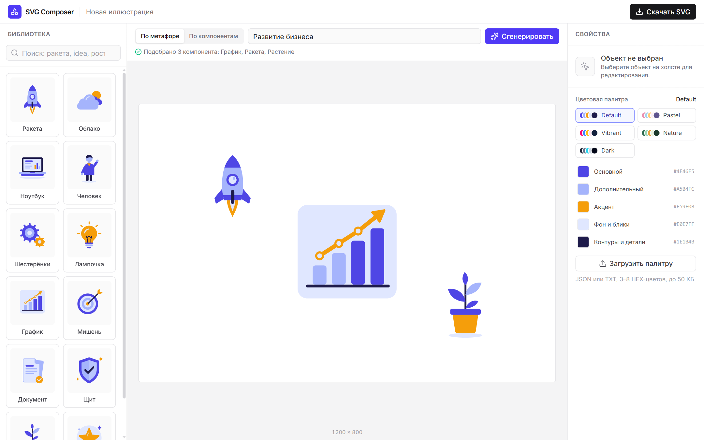
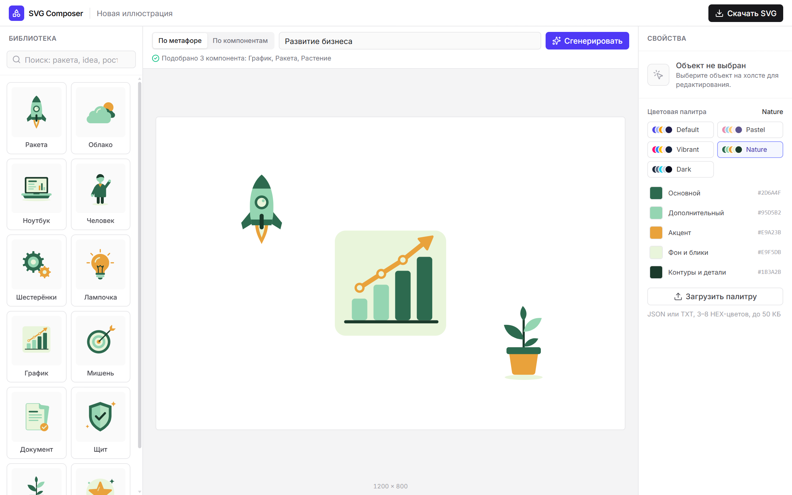
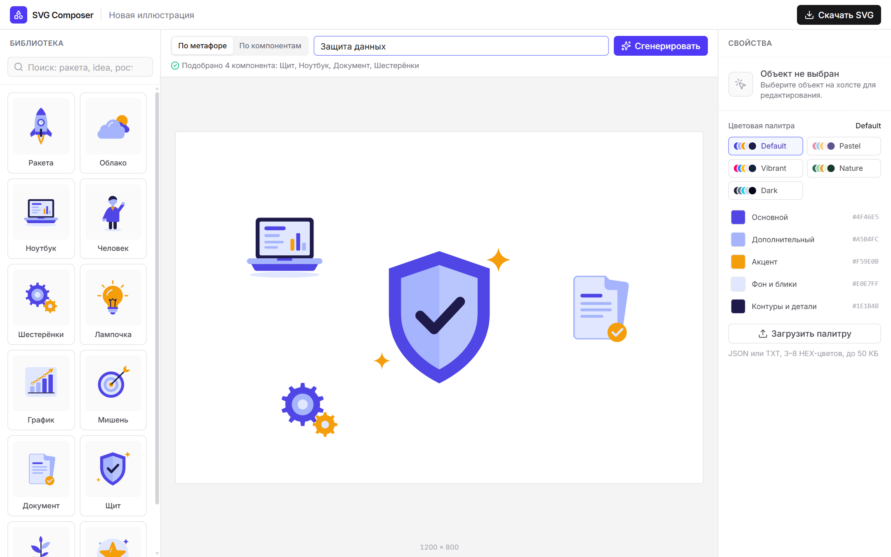
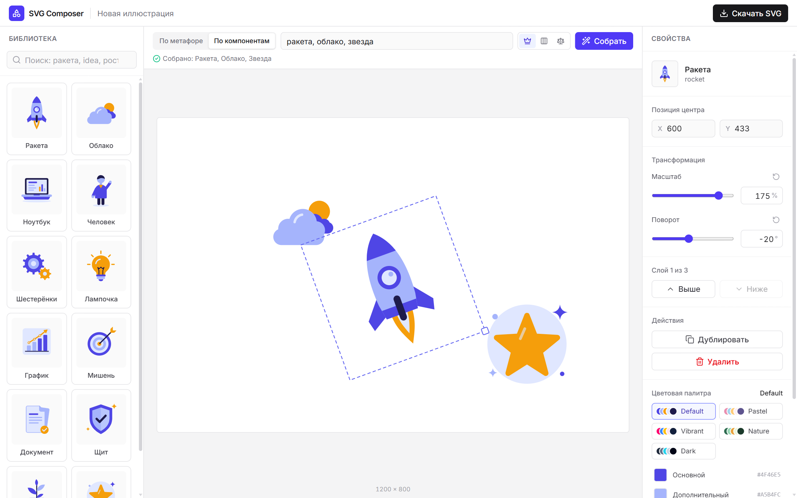

# SVG Illustration Composer

**▶ Онлайн-демо: [svg-illustration-composer.vercel.app](https://svg-illustration-composer.vercel.app)**

Веб-редактор, который собирает векторные иллюстрации из библиотеки готовых SVG-компонентов.
Пользователь описывает идею словами («Развитие бизнеса») или перечисляет объекты («ракета, облако, звезда») —
приложение подбирает компоненты, раскладывает их на холсте и отдаёт результат в виде редактируемого SVG.

Сервис не генерирует новые изображения: он компонует существующие векторные объекты, сохраняя их геометрию.
Поэтому результат можно открыть в векторном редакторе и продолжить работу с каждым объектом отдельно.

**Демо:** https://svg-illustration-composer.vercel.app



## Возможности

- **Генерация по метафоре.** Фраза на русском или английском → 3–5 подходящих компонентов, самый релевантный становится главным объектом. Нераспознанная тема даёт универсальную композицию с честным уведомлением.
- **Генерация по компонентам.** Список названий через запятую → композиция по одному из трёх шаблонов: «Главный объект», «Ряд», «Баланс». Отсутствующие компоненты не подменяются — показывается ошибка с их названиями.
- **Библиотека из 12 SVG-иллюстраций** в едином flat-стиле с поиском по названиям и тегам (RU/EN, без учёта регистра и «ё»).
- **Редактор:** перемещение мышью, пропорциональное масштабирование ручкой, поворот и масштаб из панели свойств (ползунок + точное значение), дублирование, удаление (кнопка или Delete), порядок слоёв. Объекты не выходят за границы холста с учётом масштаба и поворота.
- **Палитры:** 5 готовых (Default, Pastel, Vibrant, Nature, Dark), загрузка своей палитры из JSON или TXT, ручная правка каждого цвета. Перекрашивается вся композиция, геометрия не меняется.
- **Экспорт в SVG:** самостоятельный файл, в котором каждый объект — отдельная группа `<g>` с исходными векторными элементами, тем же transform, что на холсте, и реальными HEX-цветами. Прозрачный фон, без растровых вставок и скриптов.

## Демонстрация

| Метафора «Развитие бизнеса» → палитра Nature | Метафора «Защита данных» |
|---|---|
|  |  |

| «ракета, облако, звезда»: поворот, масштаб, перемещение | Скачанный SVG, открытый в браузере |
|---|---|
|  |  |

Пример экспортированного файла: [`examples/export-transforms-default.svg`](examples/export-transforms-default.svg).

## Технологии

React 19 · TypeScript · Vite · Tailwind CSS 4 · Zustand · нативный SVG и Pointer Events · Lucide (иконки интерфейса).
Backend, база данных и внешние API не используются — всё работает в браузере.

## Архитектура

```
src/
  types/        модели: Composition, CanvasItem, SVGComponent, Palette
  library/      SVG-компоненты как данные + поиск
  composition/  разбор запросов, смысловой подбор, шаблоны раскладки
  palettes/     палитры, resolvePalette, импорт палитр из файла
  editor/       холст, рендерер SVG-данных, геометрия, горячие клавиши
  export/       сериализация композиции в SVG и скачивание
  store/        Zustand-стор редактора
  components/   панели интерфейса
```

**SVG-компоненты** (`src/library/components/*.ts`) хранятся не как SVG-строки, а как данные: дерево `SVGElementNode`
(`path`, `circle`, `rect`, `polygon`, … и вложенные `g`) с атрибутами геометрии в собственном viewBox 200×200.
Вместо цветов у элементов указаны **цветовые роли** — `primary`, `secondary`, `accent`, `background`, `neutral`.
Новый компонент — это новый файл с данными и строка в `library/index.ts`; код редактора менять не нужно.

**Рендеринг.** Один рекурсивный рендерер (`editor/SvgNodes.tsx`) превращает данные в React-элементы SVG
без `dangerouslySetInnerHTML` и подставляет цвета активной палитры.

**Модель композиции** — единственный источник истины: `Composition { width, height, paletteId, customColors, items }`,
где `CanvasItem = { id, componentId, x, y, scale, rotation }`. `x/y` — центр объекта, порядок `items` — порядок слоёв.
Положение объекта на холсте задаёт одна функция `itemTransform()`:
`translate(x y) rotate(r) scale(s) translate(-w/2 -h/2)` — её используют и холст, и экспорт.

**Zustand** (`store/editorStore.ts`) хранит композицию, выделение и действия редактора (добавление, перемещение,
масштаб, поворот, слои, замена композиции, палитры). Ограничение по границам холста считается в одном месте —
по ограничивающему прямоугольнику повёрнутого объекта.

**Смысловой подбор** (`composition/concepts.ts`, `composition/metaphor.ts`) — локальный словарь из 10 тем
(рост, бизнес, технологии, безопасность, идеи, космос, работа, природа, цели, документы). У каждой темы есть
ключевые слова на русском и английском (основы вида `бизнес*` и точные формы) и веса компонентов.
Текст нормализуется и разбивается на слова; каждая тема получает баллы независимо, поэтому фраза из нескольких тем
учитывает их все. Дополнительно учитываются совпадения со словами-тегами компонентов. Подбор детерминирован.
Модуль изолирован: его можно заменить на LLM, не трогая редактор, — на выходе тот же список компонентов.

**Композиции** (`composition/layouts.ts`) строятся по заранее размеченным шаблонам для 1–6 объектов с проверкой
границ и пересечений; если шаблон не подходит, используется безопасная сетка. Результат — обычные `CanvasItem`,
которые редактируются теми же инструментами, что и объекты, добавленные вручную.

**Палитры.** `resolvePalette(paletteId, customColors)` — единственная точка получения таблицы «роль → цвет».
Готовые пресеты не изменяются: правка цвета создаёт пользовательскую копию. Загрузка палитры читает файл
через File API, проверяет HEX-цвета и раскладывает 3–8 цветов по ролям (недостающие выводятся из основного).

**Экспорт** (`export/svg.ts`) строит документ напрямую из модели через DOM API (`createElementNS`) и `XMLSerializer`:
корневой `<svg>` с размерами композиции, по одной группе `<g id="object-N-…">` на объект, внутри — исходные элементы
с подставленными HEX-цветами. Разрешены только векторные теги; атрибуты-обработчики, ссылки и стили отбрасываются.

## Запуск локально

Нужен Node.js 20.19+ или 22.12+.

```bash
npm install
npm run dev        # http://localhost:5173
npm run typecheck  # проверка TypeScript
npm run build      # production-сборка в dist/
npm run preview    # просмотр production-сборки
```

### Формат файла палитры

JSON:

```json
{ "name": "My Palette", "colors": ["#235789", "#59B4C3", "#F4B942", "#F4F7FA", "#253044"] }
```

TXT — HEX-цвета через перевод строки или запятую. Цвета по порядку становятся ролями
primary, secondary, accent, background, neutral; от 3 до 8 цветов, файл до 50 КБ.

## Использование AI

В работе использовались два инструмента с разными ролями:

- **ChatGPT** — анализ требований тестового задания, проектирование MVP, декомпозиция работы на этапы,
  подготовка технических заданий для каждого этапа и разбор полученных результатов.
- **Claude Code** (модель Claude Opus 5.5) — реализация приложения по этим заданиям, исправление ошибок,
  тестирование в браузере и подготовка к публикации.

Работа шла итеративно: каждый этап реализовывался, проверялся и принимался отдельно; решения о составе
этапов и приёмке результата принимались вручную.

Примеры того, как AI помогал при реализации и тестировании:

- **Векторная графика как данные.** Иллюстрации нарисованы кодом: например, обтекатель ракеты получен точным
  делением кривой Безье корпуса (алгоритм де Кастельжо), чтобы два контура совпадали без зазоров, а шестерёнки
  и звезда строятся функциями из параметров.
- **Проверка в браузере, а не только сборка.** На каждом этапе сценарии проходились реальными кликами и
  перетаскиванием во встроенном браузере. Так нашлись ошибки, которые не видны компилятору: копия объекта у края
  холста не смещалась по одной из осей; в узком окне поле генерации сжималось до нуля; подбор по метафоре ставил
  ноутбук главным объектом для «Работа с документами» из-за слишком строгого сравнения словоформ; на скриншотах
  обрезались названия палитр.
- **Сверка экспорта с холстом.** Экспортированный SVG рендерился в браузере и сравнивался с холстом попиксельно
  (0 отличающихся пикселей), а отдельный тест подавал экспортёру компонент со `<script>`, `onload` и base64-картинкой,
  чтобы убедиться, что в файл они не попадают. Скриншоты для README сняты скриптом через headless Edge
  и DevTools Protocol на production-сборке.

## Известные ограничения

- Смысловой подбор основан на локальном словаре, а не на внешней языковой модели: редкие формулировки и словоформы
  могут не распознаться — тогда используется подбор по тегам или универсальная композиция.
- Встроенная библиотека небольшая (12 объектов), поэтому одни и те же компоненты встречаются в разных темах.
- Проекты не сохраняются между перезагрузками страницы.
- Редактируются объекты целиком; редактора контуров, группового выделения и undo/redo нет.
- Импорт пользовательских SVG-объектов не реализован (палитры загружать можно).
- Совместимость экспорта проверена в браузере; файл использует только базовые возможности SVG 1.1,
  но импорт в Figma и Inkscape стоит проверить вручную.
